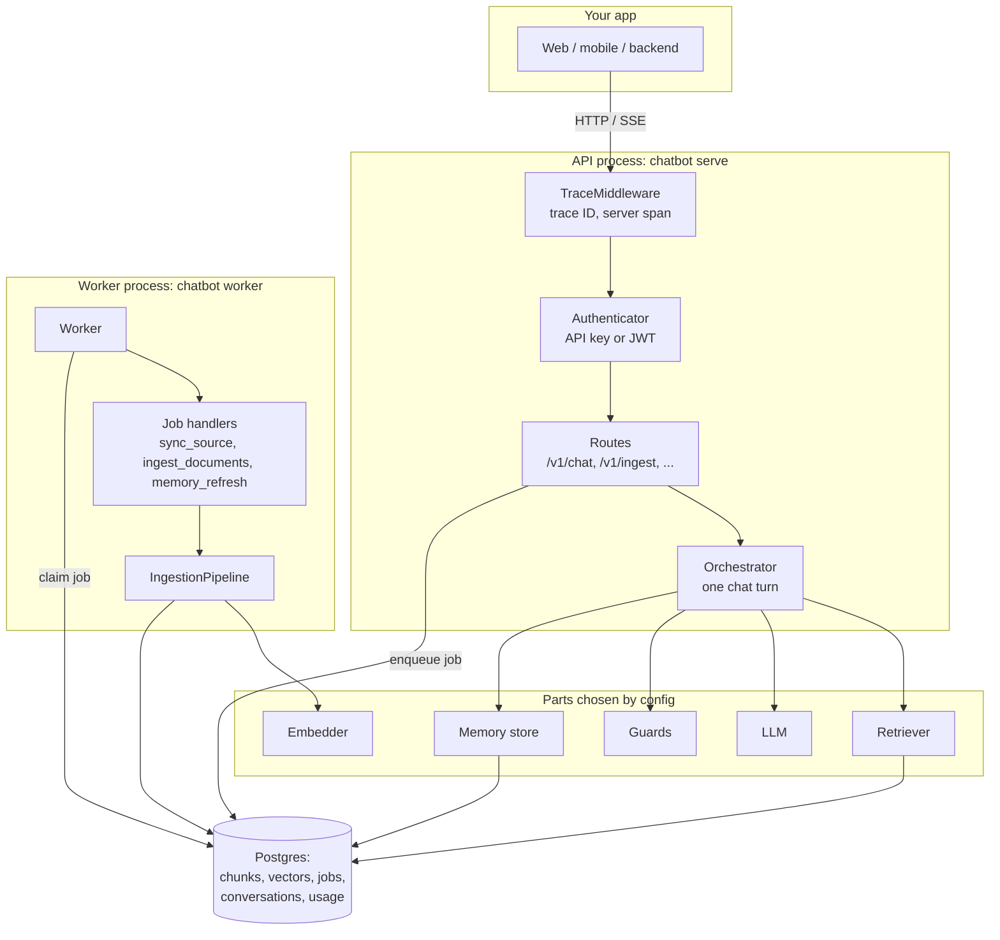
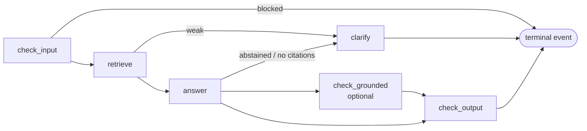

# Architecture: how the pieces fit

A guided tour for anyone opening the code for the first time. It explains the three ideas the
whole codebase rests on, then follows one chat request and one document through the system,
naming the function at each step. Read it once and every other guide will make sense.

Terms in *italics* link to the [glossary](glossary.md). Back to the [docs home](README.md).

**Contents**
[The big picture](#the-big-picture) ·
[1. Parts are Protocols](#1-parts-are-protocols) ·
[2. The registry turns names into parts](#2-the-registry-turns-names-into-parts) ·
[3. The container builds everything](#3-the-container-builds-everything) ·
[4. One chat request, start to finish](#4-one-chat-request-from-start-to-finish) ·
[5. One document, from file to vector](#5-one-document-from-file-to-vector) ·
[6. How a setting reaches the code](#6-how-a-setting-reaches-the-code) ·
[7. Things every request carries](#7-things-every-request-carries) ·
[8. Where your code goes](#8-where-your-code-goes)

---

## The big picture



Two processes share one database. The **API** answers chat requests and puts slow work
(ingesting documents, refreshing memory) in a *[job](glossary.md#job)* queue. The **worker**
takes jobs from the queue and runs them. Everything else is a *part*: a small object chosen
by config, which you can replace.

## 1. Parts are Protocols

Every replaceable part is described by a `typing.Protocol` in
[`core/interfaces.py`](../src/chatbot/core/interfaces.py): a list of methods, with no base class
to inherit. Any class that has those methods fits. This is how the template stays a set of
small pieces instead of a framework (ADR [001](adr/001-template-not-framework.md)).

| Protocol | What it does | Key method(s) | Built-in implementations |
| --- | --- | --- | --- |
| `LLM` | Writes text | `generate`, `stream` | OpenAI, Ollama, fake (offline) |
| `Embedder` | Turns text into vectors | `embed_documents`, `embed_query` | OpenAI, Ollama, hashing (offline) |
| `VectorStore` | Stores chunks and vectors, searches them | `replace_document`, `search` | pgvector, Qdrant |
| `Source` | Yields documents | `iter_documents` | files, SQL |
| `Parser` | Turns bytes into sections of text | `parse` | Markdown/text, HTML, PDF, DOCX |
| `Chunker` | Splits a document into passages | `split` | recursive |
| `Retriever` | Finds passages for a question | `retrieve` | dense, BM25 (and hybrid, HyDE wrappers) |
| `Reranker` | Re-scores the top passages | `rerank` | Cohere, local cross-encoder, lexical |
| `Guard` | Checks text at a stage | `check` | PII, injection, prompt leak, groundedness |
| `MemoryStore` | Keeps history, summaries, facts | `load`, `save_turns`, `forget_user` | Postgres |
| `JobQueue` | Background work | `enqueue`, `claim`, `complete`, `fail` | Postgres |
| `Orchestrator` | Runs one chat turn | `run`, `stream` | simple, LangGraph |

A Protocol also makes testing easy: [`testing/fakes.py`](../src/chatbot/testing/fakes.py) has
in-memory versions of the store, memory and queue, so most tests need no database.

## 2. The registry turns names into parts

Config never names a Python class. It names a *[factory](glossary.md#factory)*:

```yaml
retrieval:
  strategy: dense        # "the retriever registered as dense"
```

Implementations register their factory under a kind and a name when their module is imported
([`core/registry.py`](../src/chatbot/core/registry.py)):

```python
@registry.register("retriever", "dense")
def make_dense(embedder, store, alias, **_):
    return DenseRetriever(embedder, store, alias)
```

and the code that needs a retriever asks for it by name:
`registry.create("retriever", "dense", embedder, store, alias, settings=settings)`.

The registered kinds and names today:

| Kind | Names | Chosen by |
| --- | --- | --- |
| `llm` | `openai`, `ollama`, `fake` | the `provider` of a profile in `config/models.yaml` |
| `embedder` | `openai`, `ollama`, `hashing` | the `provider` of `models.embed` |
| `vector_store` | `pgvector`, `qdrant` | `vector_store.backend` |
| `source` | `files`, `sql` | `ingestion.sources[].type` |
| `parser` | `markdown`, `html`, `pdf`, `docx` | the document's media type |
| `chunker` | `recursive` | `ingestion.chunker.type` |
| `retriever` | `dense`, `bm25` | `retrieval.strategy`, `retrieval.hybrid.retrievers` |
| `reranker` | `cohere`, `cross_encoder`, `lexical` | the `provider` of `retrieval.rerank.model` |
| `pii_detector` | `regex`, `presidio` | `guardrails.pii.detectors` |
| `injection_detector` | `heuristic`, `llm` | `guardrails.injection.detectors` |
| `groundedness_judge` | `lexical`, `llm` | `guardrails.groundedness.judge` |
| `orchestrator` | `simple`, `langgraph` | `orchestrator` |

The modules are imported in the order of `BUILTIN_MODULES` in
[`core/container.py`](../src/chatbot/core/container.py), with `chatbot.domain` last, so a name
you register there replaces a built-in one. An unknown name fails at startup with the list of
known names.

## 3. The container builds everything

[`container.build(settings, pool)`](../src/chatbot/core/container.py) is the one place that
turns settings into objects. It builds each part in order (models, embedder, chunker, store,
memory, queue, prompts, retriever, guards, memory manager, usage store, orchestrator, ingestion
pipeline) and returns them together as `Components`. The API keeps one `Components` for its
lifetime; the worker and each CLI command build their own.

Each part goes through `part(name, factory)`: use the override passed to `build` if there is
one, otherwise build the real one. That is how tests swap in fakes:

```python
c = container.build(
    settings,
    pool=None,
    answer_llm=FakeLLM(),
    store=InMemoryVectorStore(),
    memory=InMemoryMemoryStore(),
    queue=InMemoryJobQueue(),
)
```

The container also wraps every model and embedder in a metered version
([`observability/instrument.py`](../src/chatbot/observability/instrument.py)): each call gets a
span, token and cost metrics, and a line in the usage ledger. Providers stay plain adapters
and get all of that for free.

## 4. One chat request, from start to finish

`POST /v1/chat {"message": "How long is the refund window?"}` travels like this:

| # | Where | What happens |
| --- | --- | --- |
| 1 | [`api/middleware.py`](../src/chatbot/api/middleware.py) `TraceMiddleware` | Gives the request a *[trace ID](glossary.md#trace-id)* (and a server span with tracing on); any unhandled error becomes a JSON 500 with that ID. |
| 2 | [`auth/api_key.py`](../src/chatbot/auth/api_key.py) `Authenticator` | Checks the API key or JWT; a JWT user can only act as themselves. |
| 3 | [`api/routes/chat.py`](../src/chatbot/api/routes/chat.py) `chat` | Validates the body (`ChatRequest`), then calls `orchestrator.run` (JSON) or `orchestrator.stream` (SSE). |
| 4 | `MeteredOrchestrator` in [`observability/instrument.py`](../src/chatbot/observability/instrument.py) | Opens the turn's root span, gives a first turn its conversation ID, collects usage, writes the usage record. |
| 5 | `SimpleOrchestrator._flow` in [`orchestration/simple.py`](../src/chatbot/orchestration/simple.py) | Runs the steps below over one `TurnState` ([`orchestration/state.py`](../src/chatbot/orchestration/state.py)). |

The steps of `_flow`, each a method you can read top to bottom:



| Step | Reads | Does | Sets `route` to |
| --- | --- | --- | --- |
| `check_input` | the message | input guards (length, injection, PII); loads history, summary and facts | `retrieve`, or finishes with a refusal |
| `retrieve` | the redacted question | optional query rewrite, retrieval (dense / BM25 / hybrid, optional rerank), context guards on each passage, the weak-retrieval verdict | `answer` or `clarify` |
| `answer` | the passages | renders the answer prompt, calls the model (streaming drafts if asked), aligns citations | `check_grounded`, `check_output` or `clarify` |
| `check_grounded` | answer + sources | optional groundedness check | `check_output`, `clarify`, or a refusal |
| `check_output` | the answer | output guards (PII, prompt leak) | finishes |
| `clarify` | the hits' titles | writes a clarifying question | finishes |
| `terminal` | the response | turns it into one `final`, `replace` or `refusal` event | |

`_finish` saves the turn (redacted) through the memory store and builds the response: answer,
citations, kind (`answer`, `clarify`, `refuse`), warnings, usage and the trace ID. The LangGraph
orchestrator runs the very same methods as graph nodes
(ADR [029](adr/029-langgraph-as-an-optional-orchestrator-adapter.md)).

## 5. One document, from file to vector

`make ingest` (or `POST /v1/ingest`) does not ingest anything itself: it puts a `sync_source`
job in the queue. The worker then runs:

| # | Where | What happens |
| --- | --- | --- |
| 1 | [`ingestion/jobs/worker.py`](../src/chatbot/ingestion/jobs/worker.py) `Worker.run_once` | Claims the next job (`FOR UPDATE SKIP LOCKED`), gives it a trace and a usage ledger. |
| 2 | [`ingestion/jobs/handlers.py`](../src/chatbot/ingestion/jobs/handlers.py) `sync_source` | Builds the configured source and calls the pipeline. |
| 3 | [`ingestion/pipeline.py`](../src/chatbot/ingestion/pipeline.py) `IngestionPipeline.sync_source` | For each document the source yields: |
| 3a | `parser_for(media_type).parse(raw)` | bytes → `ParsedDocument` (title, sections) |
| 3b | `ingest_parsed` | skips it if its *[content hash](glossary.md#content-hash)*, chunker version and embedding model are unchanged |
| 3c | `chunker.split(parsed)` | sections → `Chunk`s |
| 3d | `embedder.embed_documents(batch)` | chunks → vectors, in batches of 64 |
| 3e | `store.replace_document(...)` | old chunks out, new chunks in, in one transaction (ADR [013](adr/013-re-ingesting-a-document-is-an-atomic-replace.md)) |
| 4 | `sync_source`, after the loop | deletes documents the source no longer has |
| 5 | `Worker` | marks the job succeeded with the report (or failed, retrying only transient errors) |

Each step has its own guide: [sources and parsers](features/sources-and-parsers.md),
[chunking](features/chunking.md), [background jobs](features/background-jobs.md),
[re-indexing](features/reindexing.md).

## 6. How a setting reaches the code

Settings are layered, later wins:

1. [`config/app.yaml`](../config/app.yaml): every setting with its default.
2. `config/profiles/<CHATBOT_PROFILE>.yaml`: what the profile changes (`offline`, `dev`, ...).
3. Environment variables: `CHATBOT__RETRIEVAL__TOP_K=5` sets `retrieval.top_k`.

[`load_settings`](../src/chatbot/core/settings.py) merges them into one typed `Settings` object
(Pydantic). An unknown key or a wrong type stops startup with the exact path, so a typo never
silently does nothing. Secrets are never in YAML: config names the environment variable
(`api_key_env: OPENAI_API_KEY`), and `.env` holds the value. The full list is in
[configuration](configuration.md); `chatbot check-config` prints the merged result.

## 7. Things every request carries

- **A trace ID**: on the response (`X-Trace-Id`), every error body, every log line and span.
  See [observability](observability.md#trace-ids).
- **A usage ledger**: a *[ContextVar](glossary.md#contextvar)* that collects every model,
  embedding and rerank call of the turn or job, priced from `config/models.yaml`, and becomes
  one usage record ([`observability/usage.py`](../src/chatbot/observability/usage.py)).
- **One error shape**: `{"detail": ..., "trace_id": ...}` with 4xx for the caller's mistakes,
  502 for a failed provider and 500 for anything else
  ([`describe_error`](../src/chatbot/core/errors.py)).

## 8. Where your code goes

Two ways, both fine; it's your copy:

- **Add alongside:** put modules in [`src/chatbot/domain/`](../src/chatbot/domain/__init__.py)
  and import them from its `__init__.py`. It is imported last, so its registrations win. Keeps
  your code apart from the template's when you pull later improvements by hand.
- **Edit in place:** change the built-in module directly.

The [tutorial](tutorial.md) adds a new retriever end to end; [extending](extending.md) has a
recipe for each kind of part.

## Where to go next

- New to the vocabulary? The [glossary](glossary.md).
- Want to build something? The [tutorial](tutorial.md).
- Working on one feature? Its [feature guide](README.md#feature-guides).
- Why is it built this way? The [architecture decision records](adr/README.md).
