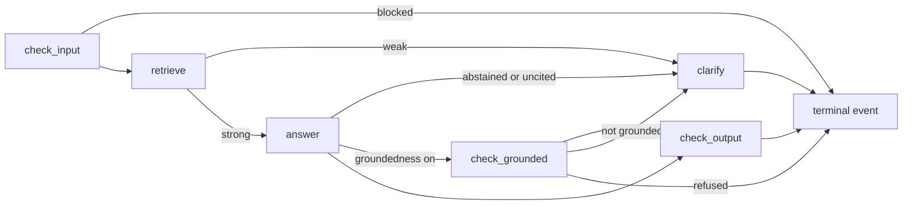

# Orchestration

The order of steps in one chat turn (check the input, retrieve, answer or ask, check the
output, save) and the one object that carries the turn's state between them. It's plain async
Python by default; the same steps can run as a LangGraph graph when you need loops, tools or
human approval.

Back to the [docs home](../README.md) · See also: [architecture, step 4](../architecture.md#4-one-chat-request-from-start-to-finish)

## At a glance

| | |
| --- | --- |
| **What it does** | Runs a turn as a chain of steps, each reading and updating one `TurnState` and naming the next step; produces delta events and exactly one terminal event. |
| **Turned on by** | Always on; `orchestrator: simple` (default) or `langgraph` in [`config/app.yaml`](../../config/app.yaml) |
| **Main files** | [`orchestration/simple.py`](../../src/chatbot/orchestration/simple.py) (`SimpleOrchestrator`: `_flow` and the steps), [`orchestration/state.py`](../../src/chatbot/orchestration/state.py) (`TurnState`), [`orchestration/langgraph.py`](../../src/chatbot/orchestration/langgraph.py) (`LangGraphOrchestrator`), `MeteredOrchestrator` in [`observability/instrument.py`](../../src/chatbot/observability/instrument.py), the `Orchestrator` Protocol in [`core/interfaces.py`](../../src/chatbot/core/interfaces.py) |
| **Depends on** | Every other part: guards, memory, the retrieval pipeline, the models, the prompts |
| **Used by** | `POST /v1/chat` ([`api/routes/chat.py`](../../src/chatbot/api/routes/chat.py)), `chatbot ask`, `chatbot eval` |
| **Decisions** | ADR [003](../adr/003-plain-python-orchestration.md) (plain Python orchestration), ADR [029](../adr/029-langgraph-as-an-optional-orchestrator-adapter.md) (LangGraph as an optional adapter), ADR [014](../adr/014-streaming-with-output-guards.md) (one terminal event) |

## What it does

Every chat turn follows the same path:



| Step | Does | Next |
| --- | --- | --- |
| `check_input` | Input guards (length, injection, PII), then loads history, the conversation summary and the user's facts. | `retrieve`, or finish with a refusal |
| `retrieve` | Rewrites a follow-up (optional), [retrieves](retrieval-strategies.md), drops passages that look like injected instructions, [assesses](weak-retrieval-and-calibration.md) strength. | `answer` or `clarify` |
| `answer` | Generates from numbered sources, aligns citations ([answers and streaming](answers-and-streaming.md)). | `check_grounded`, `check_output` or `clarify` |
| `check_grounded` | Optional: judges every claim against the cited sources. | `check_output`, `clarify`, or finish with a refusal |
| `check_output` | Output guards on the complete text; saves the turn. | finish |
| `clarify` | Asks a clarifying question (or refuses, with `on_weak_retrieval: refuse`); saves the turn. | finish |

Then `terminal` turns the result into the one terminal event (`final`, `replace` or `refusal`).

**Why plain Python?** Each step is a method you can read top to bottom and step through in a
debugger, with no framework to learn. LangGraph is there for when a turn needs more than one
pass (ADR 029); both run the very same step methods, so they behave identically.

## How it works

**The state.** [`TurnState`](../../src/chatbot/orchestration/state.py) holds everything a step
may read or write: the `request`, `draft` (streaming or not), `route` (the next step), `ctx`
(history, summary, facts), `question` (redacted), `query` (what was searched), `hits`,
`verdict`, `sources`, `messages` (the rendered prompt), `raw` and `answer`, `citations`,
`drafted` (text already streamed), `warnings`, `usage`, and `response` (set by the last step).

**The flow.** [`SimpleOrchestrator._flow(req, draft)`](../../src/chatbot/orchestration/simple.py)
is the whole turn as code:

```python
st = TurnState(request=req, draft=draft)
await self.check_input(st)  # -> retrieve | finish (blocked)
if st.route == "retrieve":
    await self.retrieve(st)  # -> answer | clarify (weak retrieval)
if st.route == "answer":
    async for event in self.answer(st):  # -> check_grounded | check_output | clarify
        yield event
if st.route == "check_grounded":
    await self.check_grounded(st)  # -> check_output | clarify | finish (refused)
if st.route == "check_output":
    await self.check_output(st)  # -> finish
if st.route == "clarify":
    async for event in self.clarify(st):  # -> finish
        yield event
yield self.terminal(st)
```

Steps that produce text (`answer`, `clarify`) are async generators that yield `delta` events;
the others are plain async methods. Every step that ends the turn calls `_finish`, which saves
the question and answer (redacted when `memory.redact_before_persist`), schedules the memory
refresh, builds `state.response` and sets `route = "finish"`.

**Two entry points, one implementation:**

- `run(req)` runs `_flow(draft=False)` and returns the terminal event's data as a
  `ChatResponse` (an `error` event becomes an exception, so the API answers 500 or 502).
- `stream(req)` runs `_flow(draft=…)` (drafts only in `draft_then_final` mode) and converts
  any exception into an `error` event.

**LangGraph.** [`LangGraphOrchestrator`](../../src/chatbot/orchestration/langgraph.py) subclasses
`SimpleOrchestrator`. `build_graph()` adds each step method as a node (generator steps send
their deltas through LangGraph's `get_stream_writer()`), and conditional edges follow
`state.route`. Its `_flow` runs `graph.astream(..., stream_mode=["custom", "values"])`, passes
the deltas through and ends with the same `terminal`.

**Around every orchestrator**, the container adds `MeteredOrchestrator`: it gives a first turn
its `conversation_id`, opens the root `chat` span, records the `chatbot.chat.turns` and
`chatbot.chat.duration` metrics, and writes one usage record per turn
([observability](../observability.md#what-a-chat-turn-looks-like)).

## Inputs and outputs

**In:** a `ChatRequest`: `message`, `user_id`, `conversation_id`, `filters`, `stream`.

**Out:** `run` → `ChatResponse`. `stream` → `ChatEvent`s: zero or more `delta`, then exactly one
of `final`, `replace`, `refusal` or `error`. Both are described in
[answers and streaming](answers-and-streaming.md) and the [HTTP API](../api.md#post-v1chat).

## Turn it on, change it, turn it off

The default needs nothing. To run the same flow on LangGraph:

```bash
uv sync --extra langgraph
CHATBOT__ORCHESTRATOR=langgraph
```

With Docker, build the image with the extra: `UV_EXTRAS="--extra langgraph" make up`.

| Setting | Default | Notes |
| --- | --- | --- |
| `orchestrator` | `simple` | `simple`, `langgraph`, or one you register. |
| `answer.*`, `retrieval.*`, `guardrails.*`, `memory.*` | | Change what the steps do; see each feature's guide. |

The orchestrator can't be turned off: it is the chat turn. To go back from LangGraph, set
`orchestrator: simple` and remove the extra.

## Extend it

**Change one step**: subclass `SimpleOrchestrator`, override the method, register the
subclass. Example: answer greetings without retrieving anything.

```python
# src/chatbot/domain/greeter.py
from chatbot.core.registry import registry
from chatbot.orchestration.simple import SimpleOrchestrator

GREETINGS = {"hi", "hello", "hey"}


class Greeter(SimpleOrchestrator):
    async def check_input(self, st):
        await super().check_input(st)  # guards and memory as usual
        if st.route == "retrieve" and st.question.strip(" !.").lower() in GREETINGS:
            await self._finish(st, "Hello! Ask me anything about our documentation.", "answer")


@registry.register("orchestrator", "greeter")
def make_greeter(settings, **parts):
    return Greeter(settings, **parts)
```

Import it from `src/chatbot/domain/__init__.py` and set `orchestrator: greeter`. Tracing, usage
records, saving the turn and the SSE contract all still apply, because `_finish` and
`terminal` do the bookkeeping. (Streamed, the greeting arrives as a `replace` event with no
deltas before it: nothing was drafted, so the terminal event carries the text.)

**Add steps, loops or tools**: subclass `LangGraphOrchestrator` and change `build_graph()`.
`tests/unit/test_langgraph.py` adds an audit node in a few lines:

```python
from langgraph.graph import END

from chatbot.orchestration.langgraph import LangGraphOrchestrator


class Audited(LangGraphOrchestrator):
    def build_graph(self):
        graph = super().build_graph()

        async def audit(state):
            log_somewhere(state["turn"].response["kind"])
            return state

        graph.add_node("audit", audit)
        graph.edges.discard(("check_output", END))  # route the two last steps through it
        graph.edges.discard(("clarify", END))
        graph.add_edge("check_output", "audit")
        graph.add_edge("clarify", "audit")
        graph.add_edge("audit", END)
        return graph
```

For a tool call (look up an order in your CRM), add a node that reads `state["turn"]`, adds
what it found to the sources, and routes back to `answer`; for human approval, LangGraph's
`interrupt()` with a checkpointer (`build_graph` returns the uncompiled graph, so compile it
with `checkpointer=` in your subclass).

Rules for any orchestrator:

- Exactly one terminal event per turn: end through `_finish` and let `terminal` build it.
- Run the output guards on the complete text before the terminal event, in every mode.
- Save turns through `_finish`, so redaction and memory refresh happen.

More in [extending: change the orchestration flow](../extending.md#change-the-orchestration-flow).

## Test it

```bash
uv run pytest tests/unit/test_orchestrator.py tests/unit/test_langgraph.py
```

| Test file | Covers |
| --- | --- |
| [`test_orchestrator.py`](../../tests/unit/test_orchestrator.py) | answers with citations; weak retrieval asks or refuses; injection refused; the streaming events; PII redacted before saving; history per conversation with an owner check; filters; the prompt-leak guard; `min_hits_filtered` |
| [`test_langgraph.py`](../../tests/unit/test_langgraph.py) | the same events and responses as `simple` for each kind of turn; selected by config and wrapped for tracing; errors become the `error` event; a subclass can add a node |
| [`test_ingest_to_answer.py`](../../tests/e2e/test_ingest_to_answer.py) | the whole path from files to an answer, against Postgres (`make test-db`) |

## Common problems

| Symptom | Cause | Fix |
| --- | --- | --- |
| `orchestrator: langgraph needs the langgraph extra` | Missing extra | `uv sync --extra langgraph` (Docker: `UV_EXTRAS="--extra langgraph"`). |
| Unknown orchestrator name at startup | A typo, or your module isn't imported | Check `orchestrator`; import it from `domain/__init__.py`. |
| `orchestrator ended without a terminal event` / `without a response` | A custom step returned without calling `_finish` | End every path through `_finish` (or set `route` to a step that does). |
| A custom step's text never reaches streaming clients | The step returns text instead of yielding `delta` events | Make it an async generator like `answer` and `clarify`. |
| A LangGraph node runs but the turn ends early | An edge or `route` value doesn't match the graph | Check the node's `route` against `add_conditional_edges`. |

## Related

- The steps in depth: [retrieval strategies](retrieval-strategies.md),
  [weak retrieval and calibration](weak-retrieval-and-calibration.md),
  [answers and streaming](answers-and-streaming.md).
- The whole request through the code: [architecture](../architecture.md#4-one-chat-request-from-start-to-finish).
- Tracing a turn: [observability](../observability.md#what-a-chat-turn-looks-like).
- Terms: [orchestrator](../glossary.md#orchestrator), [guard](../glossary.md#guard),
  [trace ID](../glossary.md#trace-id).
